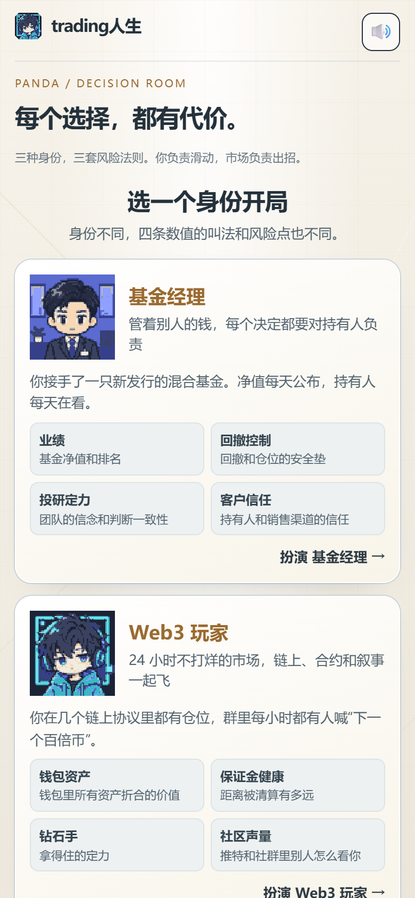
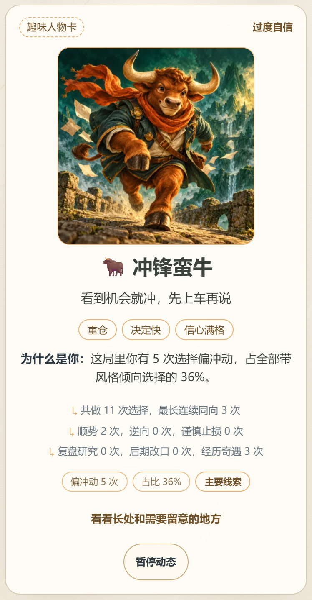
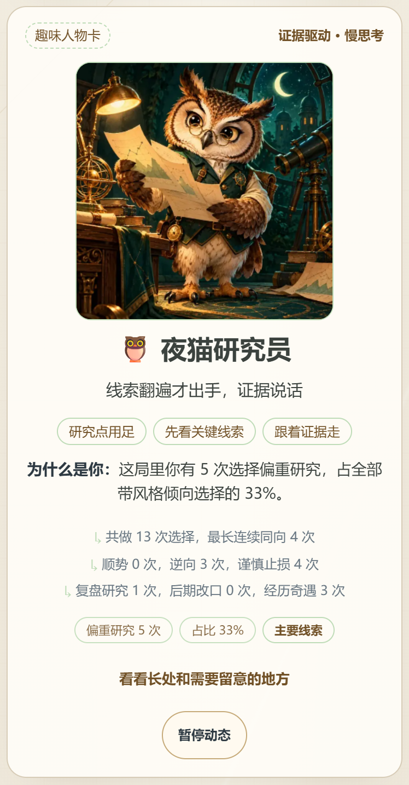

# trading人生

PandaAI 苏客松「寻找你的交易人格」参赛作品。

一款几分钟能玩完的滑牌小游戏：玩家选一个身份，左滑右滑做交易中的各种决定，每个选择都会变成行为证据。游戏结束时生成交易人物卡和 AI 复盘，并把玩家引到 PandaAI 里最适合下一步体验的功能。

**在线体验（手机直接打开，无需登录）：http://106.14.38.25:8090/**

| 扫码体验 |
|---|
|  |

> 图文版项目说明（目标用户、玩法、画像依据、推荐逻辑、来源披露、已知局限）：[`docs/项目说明.md`](docs/项目说明.md)
> 赛题原文与评分维度：[`docs/brief.md`](docs/brief.md)



## 玩法

1. 选一个身份：基金经理、Web3 玩家、炒股达人。每个身份有四条数值（钱、安全垫、定力、外界认可）。
2. 每张卡是一个交易中常见的场景，左滑或右滑选一种做法。选完会看到「后来……」告诉你后果。
3. 任何一条数值触底或爆满就结局；走满 40 关会进入加时，看你能活多久。
4. 结局页给出人物卡、AI 复盘和下一步推荐。

牌库共 138 张事件卡，每个身份 16 个结局（含隐藏结局）。其中 20 张「奇遇卡」由 Panda Data 的真实历史行情改写，10 张事件会提到 PandaAI 的真实产品和活动。

## 玩完之后：画像、AI 复盘、匹配 PandaAI 功能

```
滑牌选择 → 行为标签统计 → 人物卡 + 依据
                              │
            ┌─────────────────┼─────────────────┐
            ▼                 ▼                 ▼
       AI 本局复盘      专属策略提示词      四张引流卡
    (Qwen Token Plan)   (一键带到 Qube)   (策略/工具/产品/本局遇到)
```

- **画像**：每个选项带 0 到 2 个行为标签（观望、冲动、死扛、研究、重仓集中、谨慎、顺势、逆向、应变），一局下来累计，对应 15 种人物卡。「为什么是你」只引用本局的真实计数，几种风格并列时如实写「不相上下」，不硬下结论。
- **AI 复盘**：结局页请求后端，由 Qwen Token Plan 写 2 到 3 句话。只发送汇总数据，不发送逐张卡的选择记录；模型超时或失败时自动退回规则文案，并在卡片上标注「规则版」。
- **专属策略**：每种人格对应一段 Qube 回测提示词，点按钮带着预填内容打开 PandaAI Qube。
- **引流卡**：每局 4 张，每张写明依据哪一条本局事实。策略卡看人格，工具卡看触底或爆满的那条数值，产品卡导向 Qube 或量化因子中心，「本局遇到」呼应游戏里出现过的真实产品。

| 冲动重仓型：冲锋蛮牛 | 谨慎研究型：夜猫研究员 |
|---|---|
|  |  |

同一个随机种子、同样的事件卡顺序，只改变选择方式，得到的人物卡和推荐完全不同。对比和截图见[项目说明第 4、5 节](docs/项目说明.md)。

## 怎么跑起来

需要 Node.js 22+（Vite 要求 20.19+ 或 22.12+）。前端是 React + TypeScript + Vite，没有运行时第三方依赖。

```bash
cd frontend
npm ci
npm run dev
```

浏览器打开 `http://localhost:5173/`，默认进入 trading人生。原入口 `/src/reigns/demo.html` 仍可访问。手机访问用局域网 IP，Vite 已监听 `0.0.0.0`。

```bash
cd frontend
npm run typecheck && npm test      # 类型检查 + 单元测试
npm run build                     # 默认构建 trading人生，输出到 frontend/dist/
npm run build:reigns               # 构建到 frontend/dist-reigns/
npm run start:reigns               # 单进程服务（静态文件 + AI 复盘接口），端口 8090
```

不需要登录，没有测试账号。

**AI 复盘（可选）**：设置环境变量 `QWEN_API_KEY` 后启用，变量名见 [`.env.example`](.env.example)。不设置也能完整游玩，复盘显示规则版文案。密钥只在服务端读取，前端拿不到。本地开发时另开一个终端运行 `node backend/narrate/server.mjs`（默认 8787），Vite 会把 `/api` 转给它。

线上部署、systemd 示例、防火墙和安全边界见 [`backend/deploy/README.md`](backend/deploy/README.md)。

## Panda Data 怎么用

Panda Data 的历史行情用在 20 张「奇遇卡」里，由 10 个真实行情关卡改写：

- 接口：`get_stock_daily_pre`、`get_future_daily`、`get_index_daily`、`get_trade_cal`。10 份快照共 3,234 行，带 SHA-256 校验，保存在 `backend/levels/source_data/`。
- 覆盖六类行情：假突破、上涨延续、暴跌、震荡、V 型反转、跳空；标的包含 A 股和沪金、沪银期货。
- 卡面只写「当时可见」的信息，不出现真实股票名、代码和日期；后续走势只在选完之后的「后来……」里用四舍五入的概括揭晓。
- 凭证不进前端、不进仓库。

时间口径、字段、复权方式和选段规则见 [`docs/panda-data.md`](docs/panda-data.md)。

## 目录

```
frontend/              H5 游戏（React + TypeScript + Vite）
  src/reigns/          trading人生：引擎、牌库、画像、推荐、结局页、音频、美术
  public/audio/        背景音乐与音效（全部 CC0）
  public/levels/       10 个真实行情关卡（奇遇卡的改写依据）
backend/narrate/       结局页 AI 复盘接口（Node 标准库，无第三方依赖）
backend/deploy/        单进程部署入口与部署说明
backend/levels/        Panda Data 快照、关卡生成与校验脚本
docs/                  项目说明、赛题原文、Panda Data 说明、音频致谢
```

仓库里还保留着团队早期的另一条主线（K 线观察室玩法，目录 `frontend/src/play`、`profile`、`skills`、`shell`，以及 `data/samples`）。它不是 trading人生 的一部分，提交作品以 trading人生 为准；`frontend/src/reigns` 复用了其中 `profile`、`recommend`、`shell` 里的人物卡数据、资源目录和人格插画。

## 已知局限

- 推荐和画像是规则，阈值按游戏设计定，没有用真实用户数据校准。AI 只用来写复盘文字，不参与画像和推荐的决定。
- 没有做真实用户试玩。文档里的两条路径由脚本按固定策略自动操作，是模拟玩家，不是真人记录。
- Panda Data 只用在 20 张奇遇卡里，只有 10 个样本关卡；其余卡片是原创虚构场景，卡内标注「示例内容」。
- Panda Data 没有加密货币行情，Web3 玩家的卡片只用通用量化概念。
- 没有手续费、滑点和杠杆，数值变化是游戏设定，不模拟真实交易。
- AI 复盘偶尔会退回规则版：模型超过 8 秒没响应，或同一 IP 一分钟内超过 12 次请求。
- Qube 和量化因子中心需要登录 PandaAI 账号，未登录访问会跳到登录页；引流目录是人工整理的，链接以 2026-11-01 实测为准。
- 在线地址是 HTTP，微信里打开可能提示「非官方网页」，点「继续访问」即可。
- 「更多身份」入口是灰色占位，点不进去。

## 来源披露

- **开源组件**：React 18.3.1、Vite 8.3.5、`@vitejs/plugin-react` 6.1.2、TypeScript 5.9、Vitest 4.1.0（均为 MIT 或 Apache-2.0）。后端只用 Node.js 标准库。
- **音频**：全部为 CC0 授权素材，作者与来源逐条列在 [`docs/audio-credits.md`](docs/audio-credits.md)。
- **QuantSkills**：只引用其仓库链接作为推荐目的地，没有复制源码。
- **数据**：行情来自 Panda Data；事件卡、结局和人物卡文案由团队原创，AI 协助撰写，均为虚构示例。
- **AI 工具**：AI 编程助手（Claude、OpenAI Codex）协助写代码、测试和文档；`gpt-image-2.5` 生成人物与结局插图（记录见 `frontend/src/reigns/assets/generation-log.md`）；运行时由 Qwen Token Plan 生成结局页复盘短评。画像与推荐逻辑是确定性规则。
- **赛前已有成果**：无。仓库第一个提交在 2026-10-30，全部代码、文案、美术和文档产生于比赛期间。

## 免责声明

本项目仅供游戏体验与产品研究，不构成任何投资建议。虚拟结果和趣味人格不能证明真实交易能力。
