# trading人生：用一次次选择，认识自己的交易习惯

PandaAI 苏客松「寻找你的交易人格」参赛作品《trading人生》。

- 在线体验（手机直接打开）：http://106.14.38.25:8090/
- 一句话：玩家在滑牌游戏里做决定，每个选择都会变成行为证据，游戏结束时生成交易人物卡、AI 复盘，并把玩家引到 PandaAI 里最适合下一步体验的功能。


---

## 1. 目标用户与使用场景

| | 说明 |
|---|---|
| 谁 | 对量化交易有兴趣、但还没开始用工具的新手，以及已经在用 PandaAI 但不清楚自己该从哪个功能入手的用户 |
| 在哪里 | 手机浏览器扫码即玩，不需要注册登录，不需要懂交易术语 |
| 多久 | 一局约 3 到 5 分钟（8 到 20 次左右的左右滑动） |
| 解决什么 | PandaAI 的功能很多（Qube 回测、量化因子中心、模拟赛、QuantSkills 技能包），新用户不知道从哪里开始。游戏先看出你的习惯，再按习惯推荐入口 |

## 2. 玩法

选一个身份（基金经理、Web3 玩家、炒股达人），然后像刷卡片一样左滑或右滑做决定。每张卡是一个交易中常见的场景，两个选项代表两种做法。选完之后会看到「后来……」告诉你这个决定的后果。

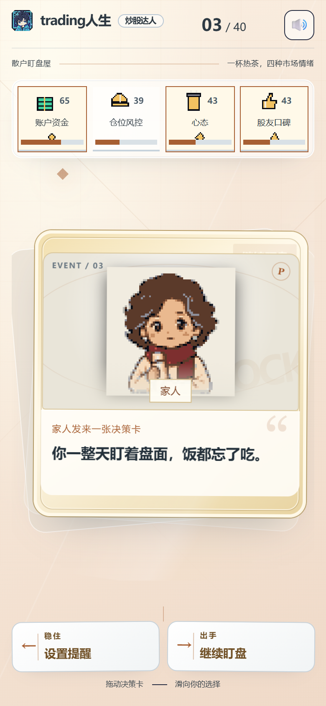

- 四条数值：每个身份有四条数值（钱、安全垫、定力、外界认可），任何一条触底或爆满就结局。拖动卡片时，会提示这个选择会影响哪几条。
- 牌库：共 138 张事件卡，按身份筛选后每个身份能遇到 81 到 93 张。其中 20 张「奇遇卡」由 Panda Data 的真实历史行情关卡改写，10 张提到了 PandaAI 的真实产品和活动。
- 结局：每个身份 16 个结局，其中有隐藏结局。
- 加时：走满 40 关后进入加时，市场开始随机抖动，看你能活多久。
- 音乐音效：游戏有背景音乐和音效，全部使用 CC0 授权素材（见第 8 节）。

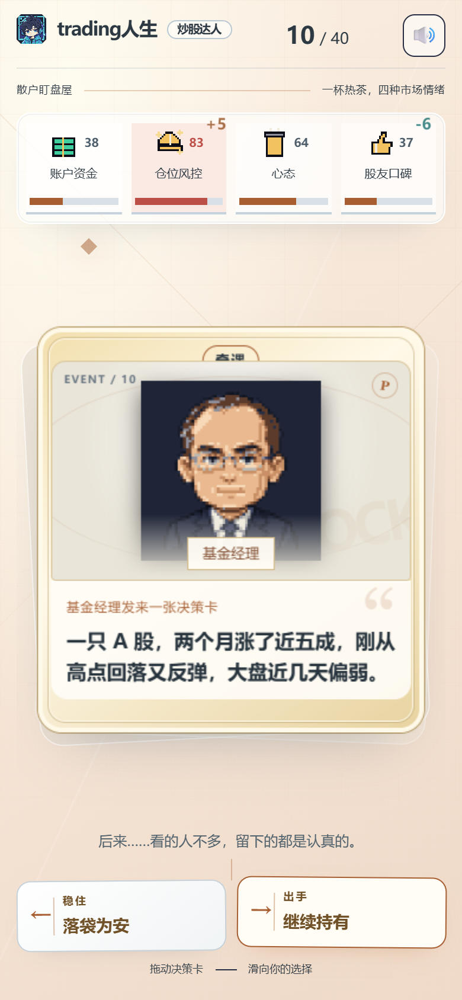

## 3. 画像：看什么，凭什么

人物卡不靠问卷，靠行为。每个选项在设计时就带有 0 到 2 个行为标签（共 9 种）：

| 标签 | 含义 | 对应的人物卡 |
|---|---|---|
| 观望 | 看得多、动得少 | 树懒观察员 |
| 冲动 | 看到机会就冲 | 冲锋蛮牛 |
| 死扛 | 亏了不认，等它涨回来 | 死扛刺猬 |
| 研究 | 先翻线索再决定 | 夜猫研究员 |
| 重仓集中 | 研究透了就下重注 | 深海猎鲨 |
| 谨慎 | 先保本金、设止损 | 稳健老龟 |
| 顺势 | 跟着趋势走 | 冲浪海豚 |
| 逆向 | 别人追涨我抄底 | 逆行螃蟹 |
| 应变 | 看情况出牌 | 灵活狐狸 |

在 9 种基础人格之外，还有 6 种需要「重复出现的行为组合」才会触发的人格：

| 人格 | 触发条件（节选自 `behavior.ts`） |
|---|---|
| 追浪海鹦 | 顺势选择 5 次以上，并且有跟风行为，或顺势次数达到逆向的 2 倍以上 |
| 逆势浣熊 | 逆向低吸 4 次以上，且超过顺势次数的 1.5 倍 |
| 断线壁虎 | 谨慎止损 4 次以上，比冒险动作至少多 2 次，且逆向低吸少于 2 次 |
| 算盘松鼠 | 复盘研究 4 次以上，谨慎动作 2 次以上，且复盘不少于冒险动作 |
| 熬夜蝙蝠 | 在深夜、凌晨类场景里追涨或冲动 2 次以上 |
| 钟摆熊猫 | 前 35% 的选择有明确倾向，后 35% 里有 4 次以上反着来，且占后半程的 65% 以上 |

合计 15 种人格。每个人格都对应一个行为金融学概念（如过度自信、处置效应、损失厌恶），人物卡上会写出来，但只是趣味表达，不是心理诊断。

### 每个结论都有依据

人物卡里的「为什么是你」只引用这一局的真实数字，并且区分几种情况：

- 某个风格唯一最高且次数不少于 3 次：写出次数和占比（例如「有 5 次选择偏冲动，占全部带风格倾向选择的 36%」）。
- 几种风格并列：写明「不相上下」，不写占比，不强行归类。
- 次数很少：写「选择比较分散」，不下结论。

卡片下方还有「本局选择轨迹」：一共选了多少次、最长连续同向几次、顺势和逆向各几次、谨慎止损几次、复盘研究几次。

| 路径一：冲动重仓型 | 路径二：谨慎研究型 |
|---|---|
| 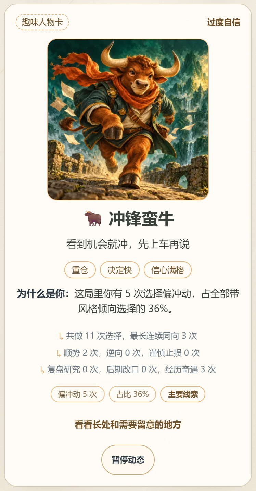 | 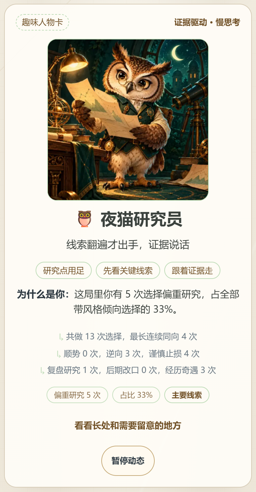 |

## 4. 两条路径，两种结果

使用同一个随机种子（seed = 1098，炒股达人），事件卡出场顺序完全一样，只改变选择策略。选择由脚本自动执行：

- 路径一：遇到追涨、加仓、重仓、硬扛一律选更激进的那一边。
- 路径二：研究、复盘、止损、减仓优先。

| | 路径一：冲动重仓型 | 路径二：谨慎研究型 |
|---|---|---|
| 结局 | 重仓失守（活了 11 关，仓位风控触底 0） | 只看不买（活了 13 关，仓位风控爆满 100） |
| 人物卡 | 🐂 冲锋蛮牛（过度自信） | 🦉 夜猫研究员（证据驱动，慢思考） |
| 依据 | 偏冲动 5 次（占 36%），谨慎止损 0 次，复盘研究 0 次 | 偏重研究 5 次（占 33%），谨慎止损 4 次，顺势 0 次 |
| 专属策略 | 给冲劲加一条 ATR 止损线 | 把研究变成多因子规则 |
| 推荐 1 | 把止损写成规则（QuantSkills 止损技能包） | 把找线索的本事用到因子上（因子大赛技能包） |
| 推荐 2 | 把这一局逐笔复盘（QuantSkills） | 养成每天收盘复盘的习惯（QuantSkills） |
| 推荐 3 | 把想法交给 Qube 回测（PandaAI） | 把研究劲头用在因子上（PandaAI 量化因子中心） |
| 推荐 4 | 第 6 关遇到的全国期货模拟赛 | 第 13 关遇到的双均线模板（Qube） |

现场如果临时改一个选择，结果也会按同一套规则变化：游戏完全由选择决定，没有随机替换人格。

## 5. 玩完之后：AI 复盘，再匹配到 PandaAI

这是整个作品最想让评委看到的一段：游戏结束后，画像不是停在一张卡片上，而是接到 PandaAI 的真实功能。

```
滑牌选择  →  行为标签统计  →  人物卡 + 依据
                                  │
                ┌─────────────────┼─────────────────┐
                ▼                 ▼                 ▼
         AI 本局复盘         专属策略提示词      四张引流卡
      （Qwen Token Plan）    （一键带到 Qube）  （策略/工具/产品/本局遇到）
```

### 5.1 AI 复盘

结局页会请求后端，由 Qwen Token Plan（主模型 qwen3.8-flash，备用 deepseek-v4.1-flash）写 2 到 3 句话的复盘。

| 路径一 | 路径二 |
|---|---|
| 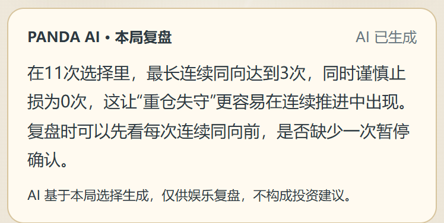 | 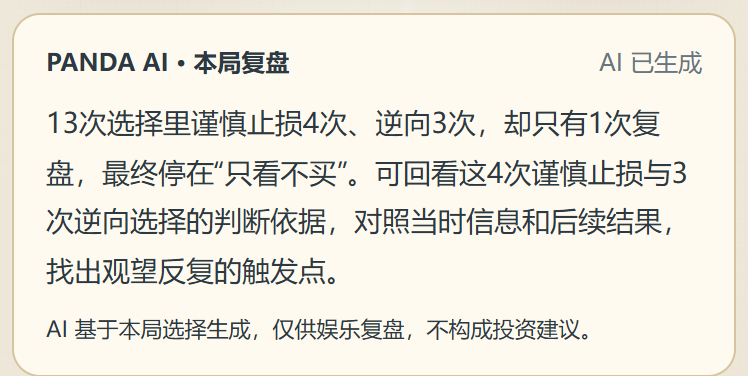 |

设计上的约束：

- 浏览器发送的是汇总数据：身份、人格、结局、四条数值、各类行为的计数（如顺势几次、谨慎几次）和最多 2 条统计句。不发送逐张卡的选择记录，不含任何个人信息。
- 提示词要求只引用输入里的证据、不评价投资能力、不给投资建议、不编造数值。
- 模型超时（8 秒）、失败或返回内容不合格时，自动退回规则文案，页面卡片上会如实标注「规则版」或「AI 已生成」，不会假装是 AI。
- 密钥只在服务端读取，前端拿不到。

### 5.2 专属策略，一键带到 Qube

每种人格对应一段专属的回测提示词，例如冲锋蛮牛对应「给冲劲加一条 ATR 止损线」。点「去 Qube 试这个思路」，会带着预填好的提示词打开 PandaAI Qube，玩家只需确认就能让 Qube 生成回测。也可以复制提示词自己用。

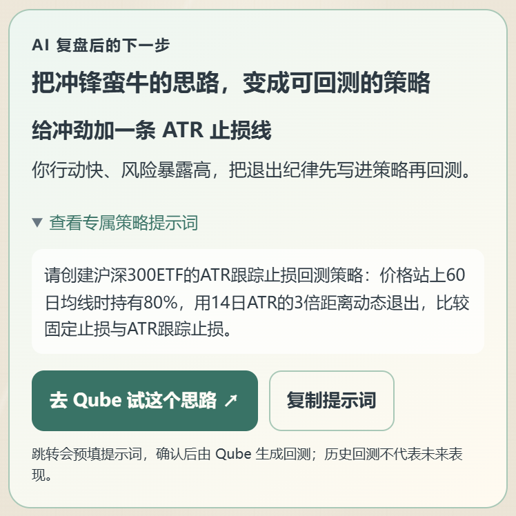

### 5.3 引流卡：玩家下一步该去哪

每局固定给出 4 张卡，每张都写明依据哪一条本局事实：

| 位置 | 作用 | 怎么选 |
|---|---|---|
| 策略 | 把风格变成可回测的规则 | 由人格决定。例如夜猫研究员对应因子大赛技能包 |
| 工具 | 补最明显的短板 | 由结局里触底或爆满的那条数值决定：资金或风控触底推荐止损技能包，信心爆满推荐校准审计，口碑相关推荐逐笔复盘 |
| 产品 | 通往 PandaAI 产品本身 | 夜猫研究员、深海猎鲨、算盘松鼠推荐量化因子中心，其余推荐 Qube |
| 本局遇到 | 呼应游戏里出现过的真实产品 | 如果玩家遇到过提到 PandaAI 产品的事件卡，就推荐它点名的那一个 |

| 路径一：以止损和回测为主 | 路径二：以因子和复盘为主 |
|---|---|
| 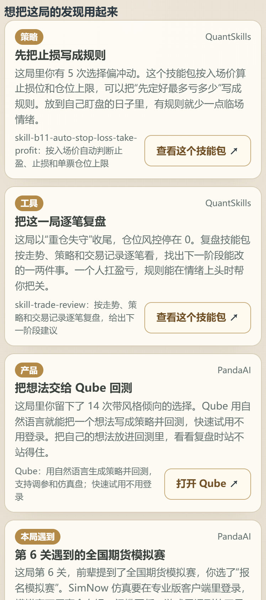 | 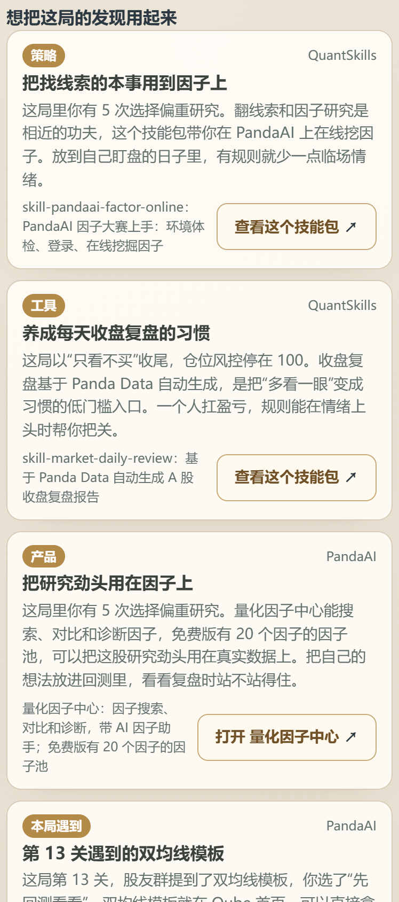 |

玩家点开后跳到的真实页面：

| PandaAI 官网 | 全国期货模拟赛 | QuantSkills 技能包仓库 |
|---|---|---|
| 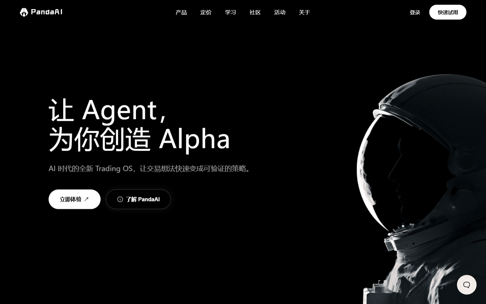 | 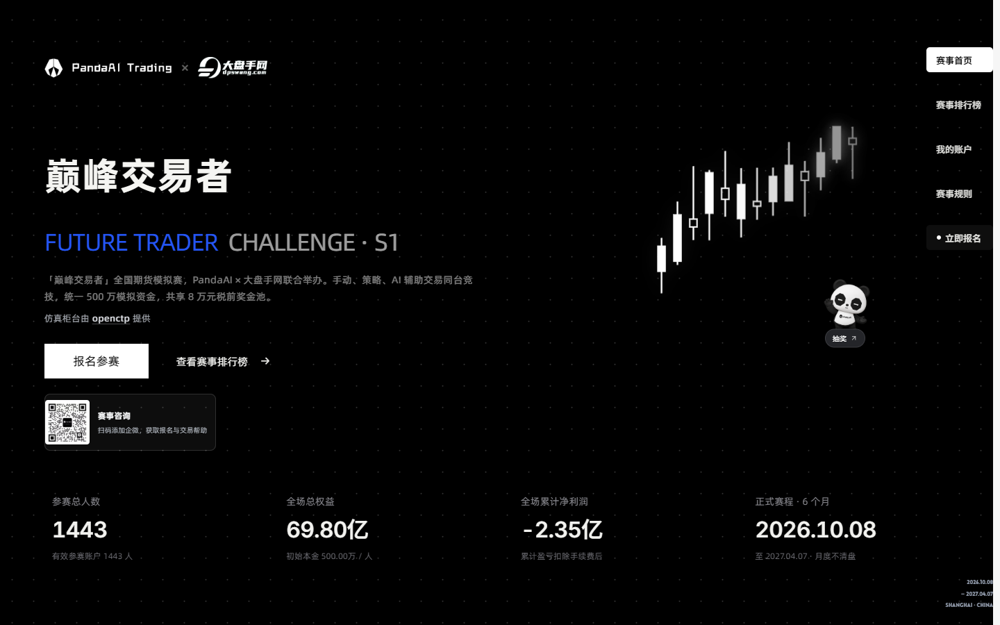 | 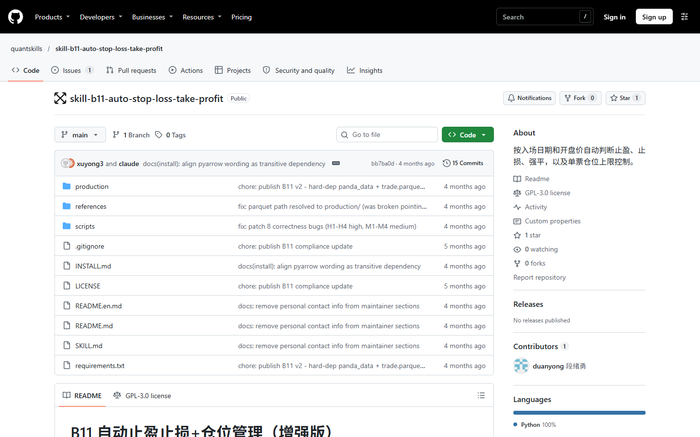 |

> 2026-11-01 实测：Qube 和量化因子中心对未登录访客都会跳到 PandaAI 登录页，需要 PandaAI 账号才能使用；全国期货模拟赛、因子大赛、QuantSkills 仓库可直接打开。游戏本身不要求登录。

## 6. Panda Data 怎么用

Panda Data 的历史行情用在 20 张「奇遇卡」里，这些卡由 10 个真实行情关卡改写：

- 数据：`get_stock_daily_pre`（A 股前复权日线）、`get_future_daily`（期货日线）、`get_index_daily`（沪深 300）、`get_trade_cal`（交易日历）。10 份快照共 3,234 行，保存在 `backend/levels/source_data/`，带 SHA-256 校验。
- 覆盖：平安银行、宁德时代、中国神华、贵州茅台、东方财富、紫金矿业，以及沪金 2504、沪银 2502 两个期货合约；涵盖假突破、上涨延续、暴跌、震荡、V 型反转、跳空六种行情。
- 怎么参与：每个关卡改写成 2 张奇遇卡。卡面只写「当时可见」的信息（行情类型、K 线形状），选完之后才在「后来……」里用四舍五入后的概括揭晓后续 15 个交易日的走势。
- 信息隔离：卡面不出现真实股票名、代码和日期，后续走势只写在选后文案里；构建脚本和测试会检查未来数据没有进入玩家可见字段。
- 凭证：Panda Data 通过官方 MCP 加本机授权取数，账号密码和 token 没有交给前端，也没有写入仓库。


## 7. 已知局限

如实列出，方便区分已完成能力和后续设想：

- **推荐是规则，不是学出来的。** 触发阈值按游戏设计定，没有用真实用户数据校准。AI 只用来写复盘文字，不参与画像和推荐的决定。
- **没有做真实用户试玩。** 文档中的两条路径由脚本按固定策略自动操作产生，是模拟玩家，不是真人记录，不能当作用户研究结论。
- **行情只占一小部分。** Panda Data 只用在 20 张奇遇卡里，只有 10 个样本关卡，其余 118 张卡是原创虚构的示例场景（卡内已标注「示例内容」）。题库不能当策略回测。
- **没有加密货币数据。** Panda Data 没有加密货币行情，所以 Web3 玩家的卡片只用通用量化概念，不使用真实行情。
- **没有手续费、滑点、杠杆。** 数值变化是游戏设定，不模拟真实交易。
- **AI 复盘偶尔会退回规则版。** 模型超过 8 秒没有响应时会降级；同一 IP 每分钟最多请求 12 次，超过后也会降级。
- **链接以 2026-11-01 实测为准。** 引流目录由人工整理，没有接入 PandaAI 的推荐接口。目录里个别文案写着 Qube「快速试用不用登录」，但实测未登录访问会跳到登录页，这句文案与实际不符，尚未修正。QuantSkills 技能包需在 AI 编程助手里加载，游戏里只能跳到仓库页。
- **在线地址是 HTTP。** 微信里打开可能提示「非官方网页」，需要手动继续访问。
- **一局的结果不能代表一个人。** 人物卡是趣味表达，不是能力评价，也不构成投资建议。
- **未实现的内容。** 「更多身份」入口是灰色占位，点不进去。

## 8. 来源披露

### 8.1 第三方组件与开源项目

| 类别 | 内容 | 许可 | 用途 |
|---|---|---|---|
| 前端框架 | React 18.3.1、React DOM | MIT | 界面 |
| 构建与语言 | Vite 8.3.5、`@vitejs/plugin-react` 6.1.2、TypeScript 5.9 | MIT / Apache-2.0 | 构建、类型检查 |
| 测试 | Vitest 4.1.0 | MIT | 849 个单元测试（31 个测试文件） |
| 运行时 | Node.js 22 | MIT | 后端和部署，后端只用标准库，无第三方运行时依赖 |
| 技能库 | QuantSkills 开源技能库 | 各仓库自带许可 | 只引用仓库链接作为推荐目的地，没有复制源码 |
| 音效 | Juhani Junkala《The Essential Retro Video Game Sound Effects Collection》 | CC0 | 卡牌、按钮等音效 |
| 背景音乐 | Zane Little Music、congusbongus、Scribe、gmason、HydroGene、Never Sleep、bertsz（均在 OpenGameArt） | CC0 | 选角页、游戏中、结局页音乐 |

音频的作者、曲目和来源链接逐条列在 [音频素材致谢](audio-credits.md)。

### 8.2 AI 工具

| 工具 | 用在哪里 |
|---|---|
| AI 编程助手（Claude、OpenAI Codex） | 协助编写代码、测试和文档。画像和推荐逻辑是确定性规则，运行时不含 AI 判断 |
| `gpt-image-2.5`（图像生成） | 人物头像、NPC、15 种人格插画、38 张结局插图；生成后经色板量化处理，生成记录见 `frontend/src/reigns/assets/generation-log.md` |
| Qwen Token Plan（qwen3.8-flash，备用 deepseek-v4.1-flash） | 运行时生成结局页的 AI 复盘短评，只收到汇总数据，不收到逐张卡的选择记录 |
| 边缘 TTS（Microsoft Edge 在线语音） | 演示视频旁白 |

状态图标、段位徽标由脚本以确定性方式绘制，没有使用 AI 生图。

### 8.3 数据

- 行情：Panda Data（PandaAI）历史行情接口。
- 事件卡文本、结局文案、人物卡文案：团队原创，AI 协助撰写，均为虚构示例。
- 所有示例数据、模拟玩家在文件名或内容里带有 `is_sample` 或 `sample_` 标记。

### 8.4 赛前已有成果

团队在比赛开始前没有已完成的作品。仓库的第一个提交在 2026-10-30，所有代码、文案、美术和文档都在比赛期间产生。比赛前已经存在的只有上面列出的开源组件、CC0 素材和 PandaAI 提供的公开接口与资源。

## 9. 比赛期间完成的核心工作

| 模块 | 内容 |
|---|---|
| 玩法与引擎 | 三个身份的滑牌游戏、纯函数引擎、四条数值、40 关加时机制、存活段位、本机最佳记录 |
| 内容 | 138 张事件卡（含 20 张由真实行情改写的奇遇卡、10 张 PandaAI 产品事件）、每个身份 16 个结局 |
| 画像 | 9 个行为标签、15 种人格的判别规则、「为什么是你」依据文案 |
| 推荐 | 策略、工具、产品、本局遇到四类引流卡的规则，15 个人格对应的 Qube 专属提示词 |
| AI | 结局页 AI 复盘服务，含限流、入参校验、降级和脱敏 |
| 数据 | Panda Data 10 份快照、10 个关卡的生成与校验脚本、信息隔离检查 |
| 美术与音频 | 角色、人格、结局、图标、徽标的接入；音频的挑选与响度统一 |
| 工程 | 849 个单元测试、类型检查、构建、部署脚本 |
| 交付 | 在线 H5、二维码、演示视频、本文档 |

## 10. 隐私与数据

- 游戏不要求登录，不收集姓名、手机号等个人信息。
- 本局的逐张选择记录只留在玩家自己的浏览器里；只有结局页的 AI 复盘会向服务端发送汇总数据（人格、结局、四条数值、行为计数、最多 2 条统计句）。服务端不写日志、不保存请求内容，只在内存里缓存相同请求的结果。
- 各身份的最佳存活关数（`reigns-best-v1`）和音量设置保存在玩家自己浏览器的本地存储里，不上传。
- 目前没有公开分享人物卡的功能，因此不会自动展示私密行为记录。
- 本文档、仓库和演示视频里没有任何数据访问密钥。密钥只放在服务器的环境变量里。
- 文档里的截图来自自动化脚本的模拟对局，不含真实用户信息。

## 11. 怎么运行

依赖、配置、启动和部署见 [部署说明](../backend/deploy/README.md)。最短的本地启动方式：

```bash
cd frontend
npm ci
npm run dev          # 打开 http://localhost:5173/src/reigns/demo.html
npm test             # 849 个单元测试
npm run build:reigns && npm run start:reigns   # 构建并启动单进程服务，端口 8090
```

不需要登录，没有测试账号。设置环境变量 `QWEN_API_KEY` 后 AI 复盘才会启用；不设置也能完整游玩，复盘会显示规则版文案。

> 本游戏仅供游戏体验与产品研究，不构成任何投资建议。虚拟结果和趣味人格不能证明真实交易能力。
